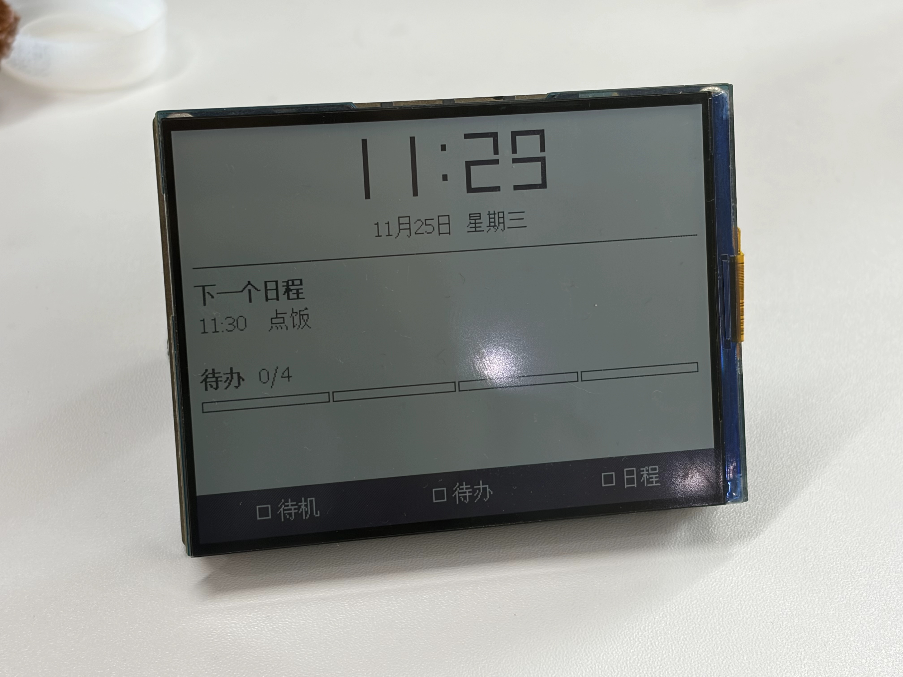
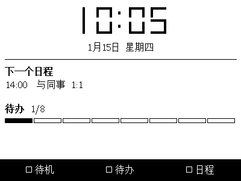
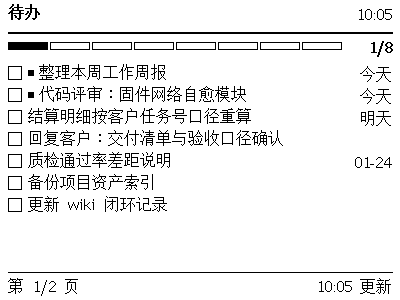
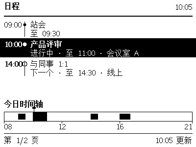
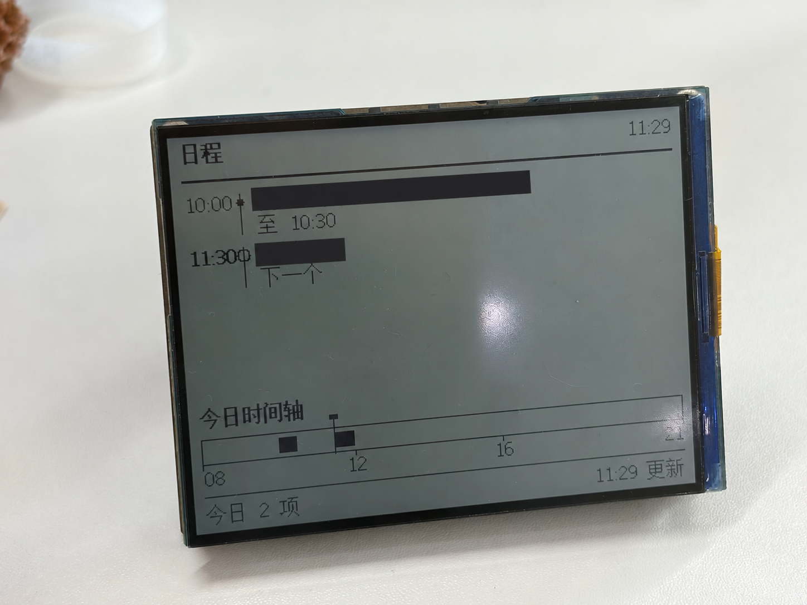

# 飞书案头屏

把飞书待办和今天的日程放到桌边。**ESP32-S3 直接连飞书，自己拉数据、排版和上屏**。完成配网和授权后，接上电就能独立运行。

Feishu Desk Display is a standalone ESP32-S3 desk dashboard for Feishu tasks and calendar events, built for the Waveshare 4.2-inch reflective LCD.

  

## 屏上有什么

- **待机**显示时钟、下一条日程和待办进度。
- **待办**分页显示任务、优先级和到期日，已完成任务有单独汇总页。
- **日程**显示当天的安排与时间轴，反白标出正在进行的事件。
- 按一次板载 **KEY** 就翻一页。飞书数据按周期刷新，翻页使用已拉到的数据。

  
  
  

三种页面的电脑预览使用模拟数据，和板子共用同一套 C 排版代码。

  

真机日程页。照片中的日程标题已遮挡。

## 从哪里开始

| 如果你想 | 从这里开始 |
|---|---|
| 先看看界面，手边没有板子 | [用模拟数据生成预览](docs/getting-started.md#在电脑上预览) |
| 把它跑在同款板子上 | [编译、烧录与飞书授权](docs/getting-started.md#上板) |
| 改排版、了解开发过程 | [设计规范](docs/设计规范_v3.md) · [项目记录](项目总览.md) |

目前面向 [Waveshare ESP32-S3-RLCD-4.2](https://docs.waveshare.com/ESP32-S3-RLCD-4.2)，使用 400 × 300 黑白反射式 LCD。编译基于 ESP-IDF v5.3，烧录和授权说明以 macOS 为例。接入真实数据需要可授权的飞书自建应用和 2.4 GHz Wi-Fi。

## 它是怎么做的

1. 板子以用户授权读取飞书待办和日程，并在板上续期。
2. 公共 C 模块解析数据、分页并生成 1-bit 画面。
3. 画面通过 SPI 刷到反射式 LCD。开发时可以在电脑上渲染同一份数据，或导出板子帧做逐像素比较。

飞书客户端在 [components/lark_api](components/lark_api)，排版和字库在 [components/shared](components/shared)，显示驱动在 [components/port_bsp](components/port_bsp)。[硬件与调试笔记](AGENTS.md)记录了分区、按键和串口约束。

如果你用同款板子复刻，欢迎在 Issues 分享实拍和遇到的问题。报错时附上板型、ESP-IDF 版本和去除凭据及真实任务内容后的日志。

## 许可

项目代码采用 [MIT](LICENSE)。[点阵字库的来源、许可和生成方式](font/README.md)。
